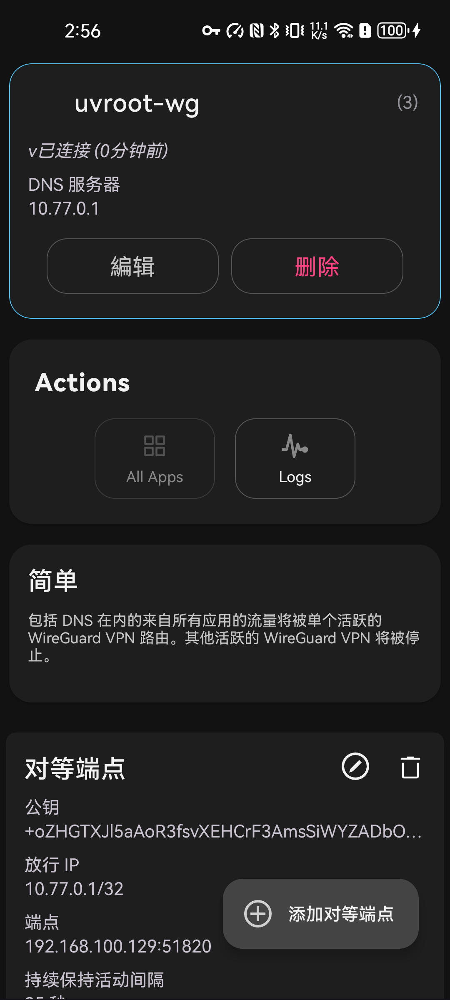
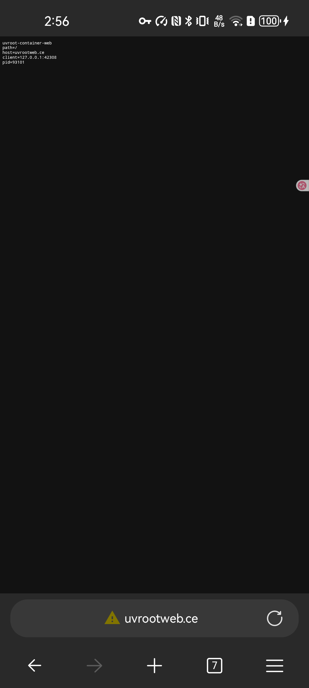

WireGuard on Android / RethinkDNS
=================================

This page records a working user-space WireGuard setup between an Android
device running RethinkDNS and an uvroot container.  It needs no root, no
kernel WireGuard module and no ``/dev/net/tun`` on the host.  The container
exposes a TCP service as port 80 inside the tunnel, while the host kernel
never binds port 80.

The two screenshots at the end were taken on the test device after the
setup was verified.

Server side
-----------

The container-side configuration is a normal wg-quick file.  ``conf=`` is
read on the host and handed to the built-in engine::

    [Interface]
    PrivateKey = <container private key>
    Address = 10.77.0.1/24
    ListenPort = 51820

    [Peer]
    PublicKey = <android public key>
    AllowedIPs = 10.77.0.2/32
    PersistentKeepalive = 25

    forward=10.77.0.1:80=127.0.0.1:8766
    forward_udp=10.77.0.1:53=127.0.0.1:15353

``forward`` is the user-space TCP terminator: a connection arriving for
``10.77.0.1:80`` is terminated by uvroot and relayed to the web service on
host loopback ``127.0.0.1:8766``.  ``forward_udp`` does the same for the
test DNS resolver.

Start it with a virtual interface address and the configuration file::

    uvroot -r / --net \
        --net-if=vtun,addr=10.77.0.1/24,up \
        --wg=vtun:conf=/tmp/uvroot-wg.conf \
        /bin/sleep 86400

The host has no kernel address ``10.77.0.1`` and no listener on port 80.
The only host listeners are the UDP WireGuard port and the high-numbered
loopback services used as forward targets.

Android client
--------------

The matching client configuration, imported into RethinkDNS::

    [Interface]
    PrivateKey = <android private key>
    Address = 10.77.0.2/24
    DNS = 10.77.0.1

    [Peer]
    PublicKey = <container public key>
    Endpoint = <host LAN address>:51820
    AllowedIPs = 10.77.0.1/32
    PersistentKeepalive = 25

The narrow ``AllowedIPs`` only sends the container address through the
tunnel; ordinary Android traffic keeps its normal route.  The DNS server is
external to uvroot.  In this test it served ``uvrootweb.ce`` as
``10.77.0.1`` and forwarded other names upstream; the client's ``DNS`` line
points at that server through the tunnel.

Validation
----------

From the Android shell::

    adb shell ping -c 1 uvrootweb.ce
    PING uvrootweb.ce (10.77.0.1) 56(84) bytes of data.
    64 bytes from 10.77.0.1: icmp_seq=1 ttl=64 time=7.79 ms

    adb shell /data/local/tmp/web_get_name uvrootweb.ce
    RESOLVED uvrootweb.ce -> 10.77.0.1
    HTTP/1.1 200 OK
    Content-Type: text/plain; charset=utf-8

    uvroot-container-web
    path=/
    host=uvrootweb.ce
    client=127.0.0.1:40170
    pid=93101

The browser screenshot below shows the same page in Edge on the device.
The URL warning is expected because the test service is plain HTTP.

   RethinkDNS: ``uvroot-wg`` is connected, the DNS server is
   ``10.77.0.1`` and the peer endpoint is the container's WireGuard port.

   Android Edge loading ``http://uvrootweb.ce/`` through the WireGuard
   tunnel; the response is the container's test web service.
